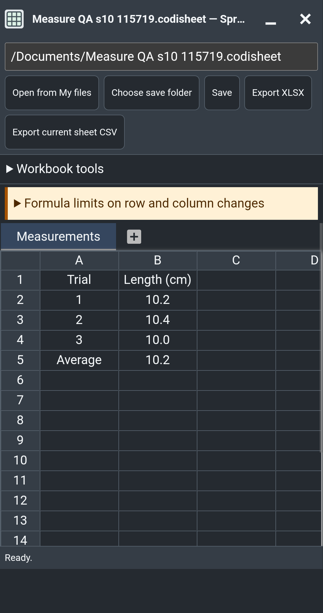

# Spreadsheet on the Galaxy S10+

Runtime source `0d7e606` in viewer `8c65e86b901e` bundles Jspreadsheet CE and the retained SheetJS conversion worker. The [app README](../../README.md) covers the file formats, export limits, and build inputs.

1. Open **Apps → Office → Spreadsheet (Jspreadsheet CE + SheetJS CE)** and choose **Workbook tools → Try measurement example**.
2. Double-tap B2, change the measurement to **10.2**, and commit. The average in B5 becomes **10.1**.
3. Enter **Documents/Measurements** in the filename field and tap **Save**. The workbook becomes `/Documents/Measurements.codisheet`. Edit B3 to **10.4** and save again. The average becomes **10.2**.
4. Export CSV and XLSX. Open the native workbook from **My files** in a fresh session. Open the two exports using the app’s file picker. XLSX keeps the formula and CSV keeps the calculated value as text.

Chrome 158 on the physical S10+ ran the portrait workflow at 411 CSS pixels. Chromium at 820 and 1300 CSS pixels repeated the workbook and both exchange formats. The filename field retained focus, and a check of every grid cell found no change while typing the name. An unsupported extension left the edit available for retry. The grid text measured 13.3:1 contrast and the toolbar and status text measured 10.1:1 in the dark palette.

The phone check covers calculation, native saving and reopening, and CSV and XLSX round trips. Formula-aware row movement, multiple worksheets, complicated XLSX formatting, and storage conflicts still need wider coverage.

On box-webhost, `sudo python3 -I -B /var/backups/webos-spreadsheet-phone-workbook-files-8c65e86b901e/deploy-viewer.py rollback` restores viewer `0a387a0bf300`.

